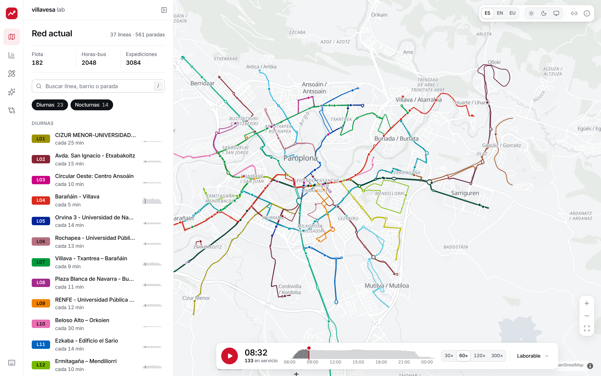
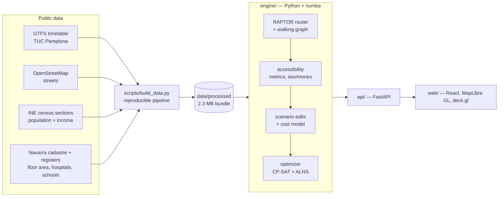
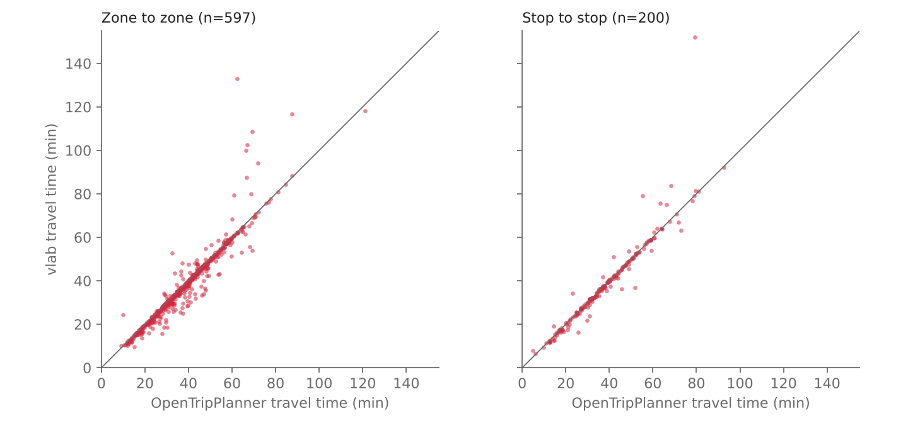

# villavesa lab

**An interactive planning tool for Pamplona's urban bus network (TUC, the "villavesas").**
See who can reach what by public transport today, edit the network — frequencies,
stops, bus priority, whole new lines — and watch the impact in about a second;
then let an optimizer propose a better network for the same number of buses.
Everything runs on public data: the official GTFS timetable, the census, the
cadastre and OpenStreetMap, with a RAPTOR router written from scratch and
validated against OpenTripPlanner.



<!-- DEMO_GIF -->

```bash
docker compose up        # then open http://localhost:3000
```

The interface is in Spanish by default, with English and Basque one click away.

---

## What it does

| | |
| --- | --- |
| **Today's network** | Every line and stop of the official GTFS on a full-bleed map, with every bus of the day moving along its route by the timetable. Click anywhere for 15/30/45-minute isochrones (walk + bus). |
| **Accessibility** | Share of residents reaching hospitals, health centres, universities, industrial estates and the city centre within a threshold, at any day and time; maps of under-served areas; equity by income. |
| **Scenario editor** | Change headways, speed up a corridor, add/move/remove stops, draw a new line snapped to streets. Every change shows a live diff: people gaining and losing access, travel time, fleet, bus-hours and cost. |
| **Optimizer** | "Given N buses, maximise accessibility": frequency reallocation (exact MILP), stop consolidation and new-line proposals (ALNS), with the budget-vs-benefit curve and an explanation line by line. |
| **Compare and report** | Before/after comparison and a self-contained, print-ready HTML report for a planner or a journalist. |

<!-- SCREENSHOT_GRID -->

## Findings

Weekday, departures 08:00–09:00, door to door on foot + bus, representative
service day 2026-11-11. The study area holds **365,400 residents**. All figures
come from the model in this repository and can be reproduced with the commands
at the end.

- **141,800 residents (39%) cannot reach at least one essential destination
  within 30 minutes** — a hospital, a health centre or the city centre.
  Health centres are close to almost everyone (99%); the gap is the hospital
  (71%) and the centre (76%). Only half of residents reach a university in 30
  minutes.
- **Outside the central city, a hospital is more than 30 minutes away for most
  people.** Every resident of Berriozar (11,200), Noáin (7,100), Berrioplano
  (6,600) and Beriáin (4,200) is beyond 30 minutes, as are 83% in Ansoáin, 89%
  in Huarte and 79% in Aranguren — against 14% in Pamplona itself.
- **Hospital access rises with income.** 67% of the lowest income fifth reach a
  hospital in 30 minutes against 87% of the highest (concentration index +0.08).
  For universities the gradient is steeper: 36% against 90% (+0.25). The
  hospitals and campuses sit in the affluent south-west.
- **Sundays are worse.** At 10:00 on a Sunday, 169,400 residents miss an
  essential destination, 19% more than on a weekday morning.
- **The same buses can do more.** Reallocating frequencies between lines with
  the same peak fleet (162 buses) raises population-weighted accessibility by
  **3.2%**, cuts the mean door-to-door trip by 22 seconds and brings an
  essential destination within reach of **6,100 more residents** — with zero
  extra buses, found in about 30 seconds. Allowing the optimizer to consolidate
  ten closely spaced stops and add one new line (Iturrama – Landaben) reaches
  **+3.7%** and 9,200 residents, still within the same fleet.
- **What a bus buys.** On the budget curve, the optimized network at 146 buses
  (−10%) still matches today's accessibility to within 0.7%; +16 buses yields
  +4.7%, and the next 16 only +0.9% more: returns diminish quickly.
- **Only 5,400 residents (1.5%) live more than a 1 km walk from any stop.**
  Coverage is not the problem; frequency and directness are.

Read these as model results, not measurements — see [Limitations](#limitations).

## How it works



### Data

A reproducible pipeline (`make data`) builds a compact bundle that is committed,
so the app runs from a clean clone without third-party servers:

- **1,794 analysis zones** of 200 m. Each census section's residents (INE, 2024)
  are spread over its cells by residential floor area from the Navarra cadastre,
  preserving every section total exactly.
- **Income** per person by census section (INE household income atlas, 2024).
- **Destinations** from official registers where they exist (hospitals and
  health centres from the Navarra health service, schools from the education
  department, industrial estates from IDENA), OpenStreetMap otherwise.
- **Pedestrian graph** (67,762 nodes) for walking and a **bus-drivable graph**
  for snapping new lines (99.3% of the GTFS shape points lie on it).

Sources, licences, dates and caveats for every dataset: [`docs/data.md`](docs/data.md).

### Router

A round-based **RAPTOR** (Delling, Pajor, Werneck) written from scratch in numba:
multi-source earliest arrival with walking access, footpath transfers, a 60 s
boarding slack and journey reconstruction. A parallel kernel computes the full
zone-to-zone matrix averaged over the departures of a time window:

| | |
| --- | --- |
| One-to-all query | 100–140 µs |
| Full 1,794 × 1,794 matrix, 6 departures | 0.4 s |
| Scenario edit (rebuild timetable) | ~2 ms |
| Evaluate a scenario end to end | 1–2 s |
| Isochrone from any point | ~50 ms |

Details: [`docs/router.md`](docs/router.md).

### Accessibility, scenarios and cost

Travel time between zones is the mean over departures every 10 minutes of walk +
bus + walk. From the matrix: time to the nearest destination of each kind,
residents within a threshold, a Hansen accessibility index, a demand-weighted
mean travel time (gravity model fixed on the baseline) and equity by income
quintile. Scenario edits are pure transformations of the timetable; fleet is
the peak number of buses committed including layover (which equals cycle time /
headway for a regular line); cost uses the operator's actual two-part tariff.
Details: [`docs/engine.md`](docs/engine.md).

### Optimizer

1. **Frequency reallocation as an exact MILP.** Each line picks one frequency
   factor; the benefit follows the waiting-time law (`∝ 1 − 1/f`), calibrated
   per line with two router evaluations; the buses each option uses are measured
   on the timetable. A multiple-choice knapsack solved to optimality with
   OR-Tools CP-SAT.
2. **Stop consolidation**, greedy, each removal judged by the router.
3. **New lines by ALNS** over street-following candidates built from unmet
   demand; whatever the new lines cost is paid for by re-solving the knapsack,
   so every solution respects the budget.
4. **Local search with the real router** and an exact final evaluation.

Why this design, and its limits: [`docs/engine.md`](docs/engine.md#optimizer-vlaboptimize),
decision D-013 in [`docs/decisions.md`](docs/decisions.md).

## Validation

**Against an independent router.** 800 origin–destination pairs (600
population-weighted zone pairs, 200 stop pairs; fixed seed) compared with
**OpenTripPlanner 2.8.1** on the same GTFS and OSM extract, parameters aligned
(walk speed, boarding slack, transfers). Error = ours − OTP, in minutes:

| Set | n | median | MAE | RMSE | p90 | ≤ 1 min | ≤ 2 min | ≤ 5 min | Spearman |
| --- | --- | --- | --- | --- | --- | --- | --- | --- | --- |
| All pairs | 797 | −0.38 | 2.07 | 5.85 | 5.06 | 67.6% | 79.4% | 89.8% | 0.979 |
| Zone to zone | 597 | −0.43 | 2.18 | 5.76 | 5.48 | 65.0% | 77.6% | 88.8% | 0.976 |
| Stop to stop | 200 | −0.18 | 1.76 | 6.10 | 3.19 | 75.5% | 85.0% | 93.0% | 0.989 |

These are the numbers of the first full run. The largest differences come from
our 1 km limit on walking to a stop (OTP has none) and from "knife-edge"
connections where a few seconds of walking decide whether a bus is caught; with
the limits lifted and OTP's effective walking speed matched, RMSE falls to 2.4
min and 95.6% of pairs agree within 5 min. No router bug was found. Full method,
alignment table, outlier diagnosis and reproduction: [`docs/validation.md`](docs/validation.md).



**Against a brute-force reference.** RAPTOR arrival times match an independent
time-expanded implementation exactly on 270 random real-feed queries, in every
round; 400 reconstructed journeys are checked leg by leg.

**Against reality.**

| | This model (2026 feed) | Reported |
| --- | --- | --- |
| Commercial speed, day lines | 12.3 km/h | 12.7 km/h (MCP, 2023) |
| Peak fleet | 162 buses | 159 buses owned (2023) |
| Bus-hours per year | 673,000 | 624,817 (2023) |
| Km per year | 8.34 M | 7.99 M (2023), 8.12 M (2024) |
| Operating cost per year | EUR 39.5 M | EUR 34.7–37.0 M (2023) |

Sources for the reported figures: [`docs/reference_facts.md`](docs/reference_facts.md).

## Limitations

- **Demand is modelled, not observed.** No public origin–destination matrix
  exists for the Comarca, so trips follow a gravity model built from population
  and activity. The decay parameter is an assumption.
- **Population within a census section is estimated** (by residential floor
  area), and **activity is floor area, not jobs**.
- **Travel times are scheduled times.** No delays, crowding, vehicle capacity or
  fares; access to stops is on foot only, up to 1 km.
- **Results refer to one analysis window** (by default a weekday, 08:00–09:00).
  The optimizer measures benefit there while frequency changes apply all day.
- **Costs use the operator tariff of the pre-2024 concession** (2023 prices);
  the current contract's unit prices are not public.
- **The feed covers 10–30 November 2026**; one representative weekday, Saturday
  and Sunday are used.
- **New lines** are scheduled at the network's mean commercial speed and, in the
  optimizer, reuse existing stops; moving a stop does not reroute buses.
- The walking graph excludes trunk roads without sidewalk tags, which makes a
  few trips detour (seen in the validation outliers).

## Run it

**Docker** (the only requirement):

```bash
docker compose up
```

Then open http://localhost:3000. The API takes a little while to become ready
on the first start (it compiles the routing kernels); the app waits for it.

**Development** (Python ≥ 3.12 with [uv](https://docs.astral.sh/uv/), Node 22):

```bash
make setup
```

```bash
make api
```

```bash
make web
```

**Checks**:

```bash
make lint typecheck test
```

```bash
cd web && npm run lint && npm run typecheck && npm test && npm run e2e
```

**Rebuild the data bundle from the public sources** (about two minutes):

```bash
make data
```

**Reproduce the validation**: see [`validation/README.md`](validation/README.md).

## Repository map

| Path | What |
| --- | --- |
| `engine/src/vlab` | GTFS, walking graph, RAPTOR, accessibility, scenarios, cost, optimizer |
| `api/src/vlab_api` | FastAPI layer ([contract](docs/api.md), OpenAPI at `/api/docs`) |
| `web/` | React + TypeScript + MapLibre GL + deck.gl ([design system](docs/design.md)) |
| `scripts/build_data.py` | Reproducible data pipeline |
| `validation/` | OpenTripPlanner comparison |
| `docs/` | Plan, decisions, data, router, engine, validation, screenshots |

## Data and licences

GTFS: TCC Pamplona via Spain's National Access Point. Census and income: INE.
Cadastre and registers: Gobierno de Navarra (IDENA), CC BY 4.0. Streets:
© OpenStreetMap contributors, ODbL. Basemap: OpenFreeMap. Code: MIT.

This is an independent project and is not affiliated with the Mancomunidad de
la Comarca de Pamplona or the operator.
