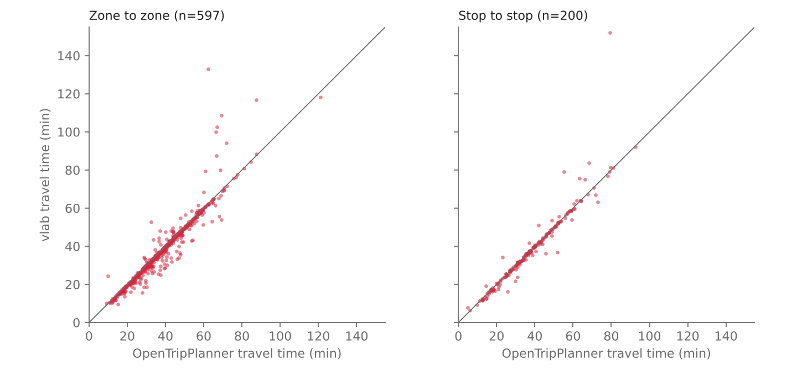
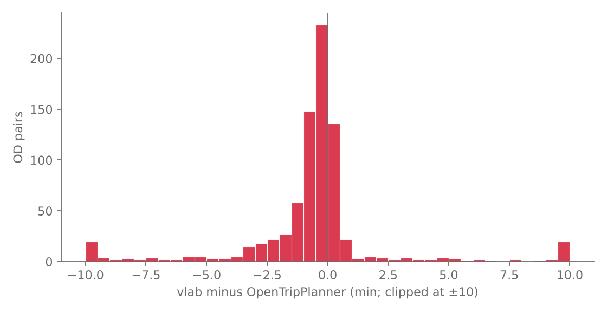
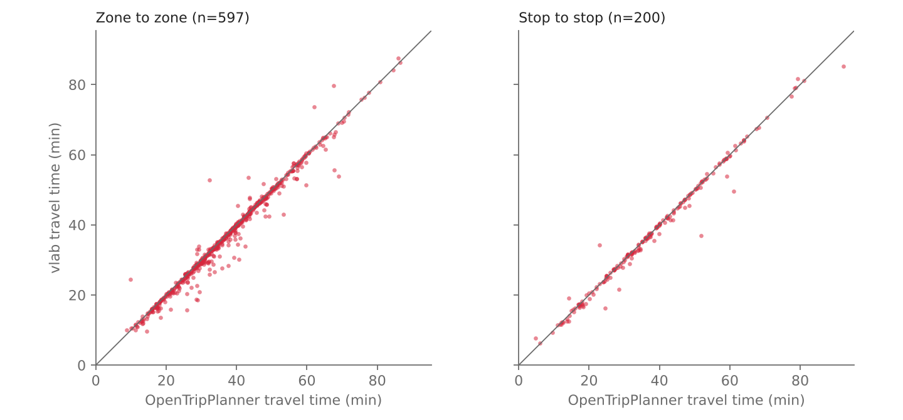
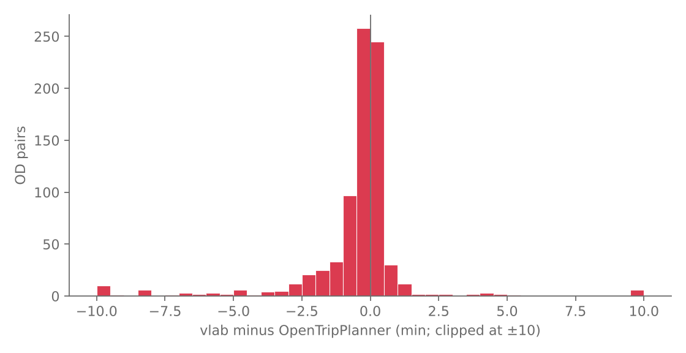

# Router validation against OpenTripPlanner (M11)

**Question.** Does our from-scratch RAPTOR router (`vlab.raptor` + `vlab.walk`) return the
same door-to-door earliest-arrival times as an independent, widely used router?

**Answer in one paragraph.** On 800 random origin-destination pairs (600 population-weighted
zone pairs, 200 stop pairs) the router agrees with OpenTripPlanner 2.8.1 with a Spearman
correlation of 0.98, a median error of -0.4 min, a mean absolute error of 2.1 min and 90 % of
the pairs within 5 minutes; 4.8 % of the pairs differ by more than 10 minutes, split evenly
between ours-slower and ours-faster. The large errors are almost entirely *explained*, not
random: (1) our 1 km access/egress limit (documented design choice) versus OTP's 45 min;
(2) timetable "knife edges": a 5-30 s difference in walking time to a stop turns a caught
bus into a missed one and costs one headway (10-35 min); OTP's walking is on average 4.3 %
slower than its nominal speed; (3) a handful of walking-network differences. After
aligning the walking model and lifting our access/egress/transfer limits the error falls to
MAE 1.0 min, RMSE 2.4 min, 95.6 % within 5 min (the noise floor of OTP against itself with a
+-4 % walking speed is MAE 0.6 min). No bug in the router or the walk layer was found; two
modelling differences are flagged in section 7.

## 1. Setup

| Item | Value |
| --- | --- |
| Reference | OpenTripPlanner **2.8.1** (`otp-shaded-2.8.1.jar`, Maven Central, SHA-1 verified), GraphQL `planConnection` |
| Why 2.8.1 | the pre-downloaded 2.10.0 and 2.9.0 jars are compiled for Java 25 (class file 69); the machine has Java 21. 2.8.1 is the newest release that runs there. |
| Transit data | the same `data/raw/gtfs_tuc_pamplona.zip`; OTP graph built with service days 2026-11-01..2026-12-01; query day **2026-11-11** (Wednesday), CET (UTC+1) |
| Street data | the same `navarra-latest.osm.pbf` clipped (`osmium extract`, complete ways) to the study area + 2 km (6 MB). **Our walk graph and OTP's street graph are built independently from this OSM data with different tag filters and snapping.** |
| Our side | `vlab` as committed: `load_feed`, `build_timetable(2026-11-11)`, `WalkGraph`, `build_access` (1 km) and `build_transfers` (400 m), `raptor_from_access` (4 rounds, 60 s slack), best over stops of arrival + egress, minimum with the direct walk (`WalkGraph.shortest_path`) |
| Sample | `validation/results/ods.csv`, seed 20261111. **600 zone pairs**: origin and destination zone drawn with probability proportional to population from the 200 m cells of `zones.parquet`, centroids as coordinates, straight-line distance >= 500 m (median 3.3 km). **200 stop pairs**: two distinct GTFS stops, uniform, >= 500 m (median 3.9 km). Each pair has one departure drawn from 08:00, 08:20, 08:40, 12:00. |
| Metric | travel time = arrival - departure (s), earliest arrival (no waiting at the origin is deducted: both tools are asked to depart at exactly the sampled time and may wait anywhere) |
| OTP query | walk + bus only, `searchWindow` 2 h, `first: 100`, **minimum arrival over all returned itineraries** (including walk-only), so OTP's generalised-cost ranking does not matter. Re-running with 30 instead of 100 itineraries gives identical arrivals. |
| Error sign | `error = ours - OTP`; negative = ours is faster |

"Stop-to-stop" pairs use the stop coordinates as origin and destination (snap distances of
a few metres), so they reduce, but do not remove, the influence of the walking network.

## 2. Parameter alignment

| Parameter | Ours | OTP setting | Remaining difference / how quantified |
| --- | --- | --- | --- |
| Walk speed | 1.25 m/s | `walk.speed: 1.25`, `reluctance: 1.0`, `boardCost: 0` | **OTP's effective speed is lower**: median walk-only distance/duration = 1.196 m/s (-4.3 %). OTP's walking time exceeds distance/speed (consistent with delays at crossings or intersections; not verified in OTP's code). Quantified with the *calibrated* OTP run (`speed: 1.307` gives an effective 1.253 m/s). |
| Board slack | 60 s before **every** boarding incl. the first | `boardSlack` 60 s | same semantics (checked on itineraries) |
| Alight slack | none | `alightSlack` 0 s | - |
| Transfer slack | none (only board slack) | `transferSlack` 0 s, transfer cost 0 | - |
| Max rides | 4 (<= 3 transfers) | `maximumTransfers: 3` | OTP with no cap gives bit-identical arrivals (`nocap` run): the cap never binds in this sample |
| Optimisation | pure earliest arrival | cost-based, so we take the earliest arrival among up to 100 itineraries in a 2 h window | walk reluctance 1, wait reluctance 1, transfer penalty 0, so the cost is close to time |
| Access/egress limit | 1 km network distance | OTP default (45 min of walking, ~3.4 km; not set explicitly; itineraries with up to 39 min of walking at one end were observed) | **quantified** with ours at 3.4 km (`accwide`) |
| Transfer footpaths | stop to stop <= 400 m, one hop | OTP default street-routed transfers (longest transfer walk used in OTP's itineraries: 935 m; the median itinerary has none) | **quantified** with ours at 1 km (`xferwide`) |
| Walking network | own OSM filter (`walk_graph.py`), 3-node snapping within 250 m, edges <= 60 m | OTP's OSM mapper, single nearest-edge snapping | **measured** from 790 walk-only pairs: ratio of our walking distance to OTP's: median 0.994 (p5 0.952, p95 1.028); 5 pairs > 15 % longer in ours, 1 pair > 15 % shorter (section 5) |
| Service day / overnight | `build_timetable(2026-11-11)` incl. carry-over from the previous day | OTP service days of the feed | no sampled departure is near midnight |
| Modes | all GTFS routes are buses (`route_type` 3) | `transit: [{mode: BUS}]`, `direct: [WALK]` | - |
| Pickup/drop-off, transfers.txt, frequencies | not modelled | feed has none (all 0, no transfers.txt, no frequencies) | OTP reports 0 constrained transfers |

## 3. Headline results (first full run, nominal alignment)

These are the numbers of the first complete run (`results/otp_main.csv` vs
`results/ours_main.csv`); nothing was tuned or filtered afterwards. Aligned runs are in
section 4 and are reported separately.

Pairs reachable in both: 797 / 800; **3 only in ours** (OTP answers `NO_STOPS_IN_RANGE` because
it snapped the point to an unconnected street piece, see section 5); none only in OTP.
Statistics are over the pairs reachable in both. Errors in minutes, `ours - OTP`.

| Set | n | mean | median | MAE | RMSE | p90 abs | p95 abs | within 1 min | within 2 min | within 5 min | Pearson | Spearman |
| --- | --- | --- | --- | --- | --- | --- | --- | --- | --- | --- | --- | --- |
| zone to zone | 597 | -0.39 | -0.43 | 2.18 | 5.76 | 5.48 | 10.54 | 65.0 % | 77.6 % | 88.8 % | 0.951 | 0.976 |
| stop to stop | 200 | +0.23 | -0.18 | 1.76 | 6.10 | 3.19 | 9.02 | 75.5 % | 85.0 % | 93.0 % | 0.948 | 0.989 |
| **all** | 797 | -0.23 | -0.38 | 2.07 | 5.85 | 5.06 | 9.49 | 67.6 % | 79.4 % | 89.8 % | 0.950 | 0.979 |

Mean travel time 38.5 min (OTP) vs 38.3 min (ours). 77 % of the pairs have the same number of
transfers. 26 % of the pairs are slower in ours, 73 % faster or equal (OTP's walking is slower,
below). 38 pairs (4.8 %) differ by more than 10 minutes (19 ours slower, 19 ours faster),
81 (10.2 %) by more than 5. Mean absolute error by departure time: 2.4 min (08:00), 1.9
(08:20), 2.0 (08:40), 2.0 (12:00), so no peak/off-peak effect.





(The long tail is clipped at +-10 min in the histogram; the isolated point at 152 vs 80 min in
the stop panel is pair 741, an egress-limit case.)

## 4. What explains the differences: alignment variants

Same 800 pairs, same ours/OTP outputs, one change at a time (all vs `all` pairs reachable in
both). `calib` = OTP walk speed 1.307 so that its effective speed is 1.253 m/s; `wide` = our
access/egress limit 3.4 km and transfer limit 1 km (the equivalents of OTP's behaviour).

| Run | ours | OTP | mean | median | MAE | RMSE | p90 | p95 | <= 1 min | <= 2 min | <= 5 min | Spearman |
| --- | --- | --- | --- | --- | --- | --- | --- | --- | --- | --- | --- | --- |
| **main** (first run) | 1 km / 400 m | nominal | -0.23 | -0.38 | 2.07 | 5.85 | 5.06 | 9.49 | 67.6 % | 79.4 % | 89.8 % | 0.979 |
| OTP without transfer cap | 1 km / 400 m | `maximumTransfers` unlimited | -0.23 | -0.38 | 2.07 | 5.85 | 5.06 | 9.49 | 67.6 % | 79.4 % | 89.8 % | 0.979 |
| our access/egress 3.4 km | 3.4 km / 400 m | nominal | -1.10 | -0.48 | 1.52 | 3.06 | 3.64 | 7.59 | 68.4 % | 80.6 % | 92.1 % | 0.980 |
| our transfers 1 km | 1 km / 1 km | nominal | -0.50 | -0.42 | 1.91 | 5.50 | 4.37 | 8.66 | 67.5 % | 79.9 % | 90.8 % | 0.981 |
| both limits lifted | 3.4 km / 1 km | nominal | -1.19 | -0.48 | 1.52 | 3.08 | 3.58 | 7.52 | 68.3 % | 80.6 % | 92.2 % | 0.981 |
| OTP walk calibrated | 1 km / 400 m | speed 1.307 | +0.46 | -0.10 | 1.78 | 5.77 | 3.92 | 8.29 | 75.2 % | 83.2 % | 91.8 % | 0.984 |
| **both lifted + calibrated** | 3.4 km / 1 km | speed 1.307 | -0.50 | -0.17 | **1.03** | **2.36** | 2.38 | 4.83 | 79.1 % | 88.1 % | **95.6 %** | **0.989** |
| - stop to stop only | | | -0.32 | +0.02 | 0.83 | 2.02 | 1.62 | 2.98 | 84.0 % | 92.0 % | 96.5 % | 0.992 |
| - zone to zone only | | | -0.56 | -0.20 | 1.09 | 2.46 | 2.51 | 4.92 | 77.4 % | 86.8 % | 95.3 % | 0.988 |

**Noise floor.** Because buses run every 10-35 minutes, any tiny change of walking time can flip
a connection. To measure how much disagreement is intrinsic, OTP was compared with *itself*
with a +-4 % walking speed (1.20 and 1.30 m/s, the size of the speed discrepancy above):
MAE 0.59 / 0.62 min, RMSE 2.06 / 1.83 min, p95 1.52 / 2.23 min, 97.4 % / 97.0 % within 5 min,
Spearman 0.992. The aligned run (MAE 1.03, RMSE 2.36) is therefore about 1.7 times the
noise floor, the remainder being walking-network and snapping differences.

The access/egress limit is the largest systematic contributor (RMSE 5.85 to 3.06); the
400 m transfer limit matters little (5.85 to 5.50). The residual negative mean (-0.5 min)
is the sign of OTP's slower walking: OTP spends time that ours does not model.

After alignment, 15 pairs (1.9 %) still differ by more than 10 min and 35 (4.4 %) by more than 5.





## 5. The largest discrepancies, diagnosed

Ten largest of the first run plus representative cases of each mechanism
(`validation/diagnose.py <od>`; stop ids are GTFS `stop_id`; OTP prefixes them with `1:`).
"wide" = both limits lifted.

| OD | Set | Dep | Ours | OTP | Error | Diagnosis |
| --- | --- | --- | --- | --- | --- | --- |
| 741 | stop | 08:00 | 152 min (walks) | 79 min | +73 min | **Egress limit.** OTP rides L15+L04 and walks the last 1,479 m; ours may only egress within 1 km, finds no transit journey and walks the whole way (9,116 s, 11 km). Wide: -0.3 min. |
| 149 | zone | 08:00 | 133 min | 62 min | +71 min | **Walking network.** OTP walks 1,534 m to stop 389; ours needs 3,215 m to reach it (3.2 km path). OTP's path uses two `foot=yes` ways joined by a 25 m stretch of `highway=trunk` (ring road) that our walk filter excludes. Remains +11 min after widening. |
| 413 | zone | 08:00 | 161 min (walks) | 110 min | +51 min | **Egress limit**, then unresolved: with the limits lifted ours is 16 min *faster* than OTP (L04 08:05 then 590 m walking transfer and 2.9 km egress); OTP does not produce this itinerary. |
| 190 | zone | 08:40 | 109 min | 69 min | +39 min | **Walking network** (egress from stop 210: OTP 2,715 m, ours 4,449 m for the same pair of points); not root-caused, probably the same trunk filter. Remains +10 min after widening. |
| 199, 136, 565, 705, 166, 400, 57, 728 | zone/stop | various | 79-117 min | 55-87 min | +15 to +36 min | **Access/egress limit** (OTP walks 1.1-2.2 km at one end). All eight fall to < 1.6 min with the limits lifted. |
| 545 | zone | 08:20 | 53 min | 32 min | +20 min | **Knife edge.** OTP walks 216 m to stop 522 and boards L10 at 08:24; our path is 250 m (201 s), arriving 08:23:21 + 60 s slack > 08:24:00 by 21 s, so we take the 08:50 bus. |
| 568 | zone | 08:20 | 24 min | 10 min | +15 min | **Knife edge.** Access to stop 90: ours 245 s, OTP 228 s; boarding at 08:25 needs arrival <= 08:24:00, ours is 5 s late and waits for 09:00. |
| 143 | zone | 08:20 | 54 min | 69 min | -15 min | **Knife edge, ours faster.** The footpath between stops 527 and 303 is 354 m / 283 s in ours and 362 m / 352 s in OTP (effective 1.03 m/s). OTP then misses the 08:56 L17 by 52 s. |
| 726 | stop | 08:40 | 37 min | 52 min | -15 min | **Knife edge, ours faster.** Transfer between stops 276 and 13: 58 s in ours, **143 s for 88 m** in OTP, so OTP misses the 09:06 L17 by 23 s. |
| 154 | zone | 08:00 | 25 min | 37 min | -13 min | **Knife edge, ours faster.** Walk to stop 511: ours 776 s (970 m), OTP 791 s (880 m); OTP misses the 08:14 L19 by 11 s. |
| 70, 263, 570 | zone | - | 62, 44, 28 min | no itinerary | n/a | **OTP snapping artefact.** The point snapped to a disconnected street piece (underground parking aisle in the old town); OTP says `NO_STOPS_IN_RANGE`. Moving the point 22 m makes OTP answer. |

Classification of all 38 pairs with |error| > 10 min: 13 of the 19 where ours is slower
disappear when our limits are lifted (error < 5 min); the other 6 are knife edges (545, 568),
walking-network differences (149, 190) or unresolved (413 and one more). Of the 19 where ours is faster,
none is affected by the limits and 9 disappear when OTP's walking is also calibrated; the
rest are knife edges caused by OTP's per-crossing walking delays and a few unresolved cases.

Walking-only comparison (790 pairs with an OTP walk-only itinerary): our walking distance
over OTP's has median 0.994, p5 0.952, p95 1.028; only 5 pairs are more than 15 % longer in
ours (686, 596, 624, 329, 412; the first two by 88 % and 45 %) and 1 pair more than 15 % shorter.
The two networks give the same length within +-5 % for 93 % of the pairs (within +-10 %: 98 %). Durations differ by -5.5 % (ours
faster) purely because of OTP's effective speed.

## 6. Conclusions

- **The RAPTOR core is consistent with an independent router.** 77 % of the pairs have the
  same number of transfers and 67 % the identical sequence of routes (among pairs where both
  use transit); where the route differs it is usually an equivalent connection within a headway. With the walking model aligned, 95.6 %
  of pairs agree within 5 minutes and the error is within 1.7 times the sensitivity of OTP to a
  4 % change in walking speed. That is the level at which two correct routers can be expected
  to agree on a scheduled network with 10-35 min headways.
- **The error is dominated by discrete connection flips**, not by routing logic: a few seconds of
  walking time changes the arrival by a full headway. Individual OD times are therefore uncertain by
  about +-1 headway; aggregate accessibility measures (population reaching X within 30 min)
  average over many pairs and departure samples and are far more robust than any single pair.
- **No evidence of a RAPTOR, timetable or footpath bug** in 800 pairs: every large outlier was
  traced to walking time/network, access limits or OTP behaviour. In particular, transit-only
  rides and times match the GTFS exactly (verified on the raw `stop_times` for pair 726).

## 7. Findings to act on (not bugs)

1. **Access/egress limit of 1 km** leaves some zones with no transit journey where OTP finds
   one with a 1.1-2.8 km walk. This is a design choice (documented in `docs/router.md`); the
   effect on the headline error is the largest of all (RMSE 5.85 to 3.06 min). Pairs affected:
   13 pairs (1.6 % of the sample) have a > 10 min error because of it.
2. **`highway=trunk` without sidewalk tags is not walkable** in `vlab.data.pipeline.walk_graph`.
   OTP does walk 25 m stretches of the ring road to join two footpaths (pair 149: path 1.5 km
   in OTP, 3.2 km in ours). This is conservative and defensible (the ring road is an
   expressway) but makes some peri-urban points detour by km. Reproduction:
   `uv run python validation/diagnose.py 149 --access-m 3400 --transfer-m 1000`.
3. **No walking delay at crossings.** OTP's walking is 4.3 % slower on average and more than twice as
   slow on some short crossing-heavy footpaths (88 m in 143 s). Our travel times are therefore
   slightly optimistic for walking (roughly 0.5-1 min on a 38 minute trip on average). Not
   changed: ours is the cleaner, documented model, but the figure should be quoted.

## 8. Limitations of this validation

- OTP and ours share the GTFS and the OSM extract, so they cannot detect errors in the data
  itself (e.g. a wrong timetable); they test the routing implementation and the walk layer.
- OTP is also a model with its own heuristics (its walking-time model, stop snapping
  and access/egress stop selection); agreement is not proof of reality. The walking-time model of OTP
  was not inspected in its source code: its delay at crossings is inferred from measured
  durations.
- One service day (Wednesday 2026-11-11), four departure times, 800 pairs, one departure per pair.
  Saturday/Sunday and night service were not sampled. Pairs are >= 500 m apart; very short trips
  (walking) are under-represented (10 % of the pairs are best walked).
- Only earliest-arrival times were compared, not the itineraries (77 % have the same number
  of transfers; the same route sequence for most) and not the isochrone/accessibility metrics.
- The alignment runs (`calib`, `wide`) are post-hoc and tuned on the same sample (the walk speed 1.307 was
  calibrated on walk-only durations, not on bus travel times). They show where the errors come from,
  not an out-of-sample error; the first-run numbers in section 3 are the headline.
- OTP 2.8.1, not the latest 2.10.0 (Java 21 constraint).

## 9. Reproduction

See `validation/README.md`. In short:

```bash
uv run python validation/sample_ods.py
validation/build_otp.sh serve &          # Java 21 + osmium; OTP on :8080 (needs ~4 GB)
python3 validation/run_otp.py validation/results/otp_main.csv
uv run python validation/run_ours.py validation/results/ours_main.csv
uv run --with matplotlib --with scipy python validation/analyze.py --tag main --merged --img
uv run pytest engine/tests/test_validation_otp.py   # CI regression against committed OTP answers
```
